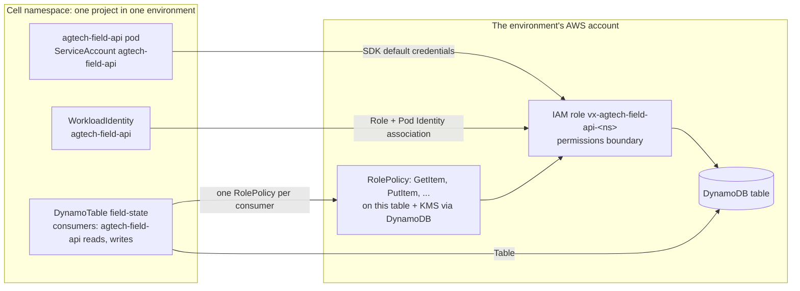
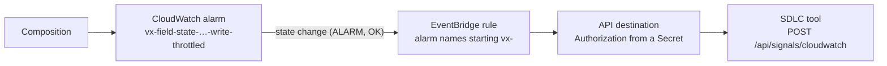

# Platform resources: cloud services for Valxel products

The cloud services products may use (constitution VX-19), as OpenChoreo ClusterResourceTypes backed
by Crossplane Compositions, one per cloud: `aws/` on AWS, `gcp/` on Google Cloud, `azure/` on Azure. The list, and what
each is for on each cloud, lives in the platform catalog (`valxel-platform/sdlc-governance`,
`platform/catalog.yaml`); this repo builds each type in it. A data plane installs the ClusterResourceTypes,
the XRDs and its own cloud's Compositions only, so each XRD has one Composition there.
PostgreSQL and Valkey come from OpenChoreo's own
[`provisioner-crossplane`](https://github.com/openchoreo/community-modules/tree/main/provisioner-crossplane)
module, which this one follows in layout and conventions.

Nobody writes these by hand per feature. The SDLC tool's architect picks types from the catalog,
G4 approves them with their access and cost, and the pipeline creates an OpenChoreo `Resource` per
service and binds it to each environment. This repo is what turns those Resources into AWS.

| Type | Builds | Kept when unbound |
| --- | --- | --- |
| `postgres` | OpenChoreo's `postgres-crossplane` (RDS) on AWS, not built here; a Cloud SQL for PostgreSQL instance of its own, private IP only, HA by size (Google Cloud) | yes |
| `key-value-table` | DynamoDB table (AWS); a Firestore database of its own, native mode, point-in-time recovery, delete protection (Google Cloud) | yes |
| `event-stream` | Kinesis stream (AWS); a Pub/Sub topic keeping `retention_hours`, with a replayable subscription per reader (Google Cloud) | yes |
| `queue` | SQS queue and dead-letter queue (AWS); a Pub/Sub topic to send to, one subscription to receive from and a dead-letter topic (Google Cloud) | no |
| `object-bucket` | S3 bucket (AWS); Cloud Storage bucket, public access prevented, uniform access (Google Cloud) | yes |
| `topic` | SNS topic (AWS); Pub/Sub topic (Google Cloud) | no |
| `dynamodb-table` | DynamoDB table: on-demand (small, medium) or provisioned (large), point-in-time recovery, deletion protection | yes |
| `kinesis-stream` | Kinesis stream: one shard (small) or on-demand | yes |
| `sqs-queue` | SQS queue plus a dead-letter queue, with an alarm when the data plane has an alarm topic | no |
| `s3-bucket` | S3 bucket: no public access or ACLs, TLS only, versioning, optional expiry and access logs | yes |
| `sns-topic` | SNS topic (never PHI in a message) | no |
| `kafka-topic` | A Kafka topic for one data contract, never picked by hand: replication 3, compacted or kept `retention_days`, a dead-letter topic; access only for the contract's owner (write) and consumers (read, their own consumer groups). MSK with IAM in production (`aws/`), Strimzi with ACLs elsewhere (`strimzi/`), both through provider-kafka | yes |
| `kafka-user` | One component's Kafka identity: nothing on MSK (IAM through its workload identity), a SCRAM user on Strimzi whose password is a Secret in its own namespace | no |
| `workload-identity` | One component's IAM role, trusted only through EKS Pod Identity for its ServiceAccount, under the permissions boundary | no |

The version 1 AWS types below the neutral ones (`dynamodb-table`...`sns-topic`) are aliases kept for the
resources made under them, which never change type: `scripts/neutral.py` writes the neutral types' AWS
side (`apis/<type>/`, `aws/<type>-composition.yaml`, its render fixtures) from them, and the tests
fail when the two drift. Change the version 1 type and run the script.

Every AWS type is encrypted with the product's KMS key and tagged with product, feature and data class,
and comes with the catalog's standard CloudWatch alarms (see [Alarms](#alarms)).

## Code runners

`code-runner` isn't an AWS service and isn't in the catalog: the SDLC tool adds one for each
code-sandbox component (valxel-platform/template-code-sandbox), and
`k8s/code-runner-composition.yaml` builds, in the component's cell namespace, what its sandboxes are:

- an Agent Sandbox 1.0 `SandboxTemplate` running the platform's runner image (`codeRunner.image` in
  `valxel-aws`, a digest of `ghcr.io/valxel-platform/code-runner`), never the component's own: under
  gVisor on the gvisor nodes, no service account token, read-only root, non-root, limits;
- a `SandboxWarmPool` (small 1, medium 3, large 6 ready), named after the resource and reported as
  `status.pool`, the component's `SANDBOX_SANDBOX_TEMPLATE`;
- a Cilium policy with deny rules: only the cell's pods reach a runner, no runner reaches another,
  and no runner reaches anything;
- a Role letting only the component's ServiceAccount create, read and delete `SandboxClaims` there.

Each data plane installs the Composition, `k8s/crossplane-rbac.yaml` (what Crossplane needs to build
it) and Agent Sandbox with the gvisor RuntimeClass (platform-foundation).

## Kafka topics

The SDLC tool writes a `kafka-topic` Resource for each approved data contract (ODCS v3, the HLD's
Datasets) and a `kafka-user` for each component the contract names, so a topic, its dead-letter
topic and every component's access to it exist only because a contract says so. Topic
auto-creation is off on every cluster.

- **Production: Amazon MSK with IAM.** Install `aws/kafka-topic-composition.yaml` and
  `aws/kafka-user-composition.yaml`. Each component's workload-identity role gets one policy per
  topic: Connect to the cluster, write (the owner) or read (a consumer) that topic, its own
  consumer groups (`<component>*`) and the dead-letter topic. MSK has no other sign-in method
  enabled. provider-kafka creates topics through MSK's Kafka API, signing in with IAM.
- **Elsewhere: Strimzi with SCRAM.** Install `strimzi/kafka-topic-composition.yaml` and
  `strimzi/kafka-user-composition.yaml`. Each component gets a SCRAM-SHA-512 user whose password is
  the Secret `<component>-kafka` in its own namespace, and ACLs for exactly the same access. The
  cluster authorizes every request, so a user with no ACL is denied.

Each data plane installs one flavour's two Compositions, and provider-kafka with a
`ClusterProviderConfig` named in `valxel-aws` (`kafka.providerConfig`).

## A transform's own database login

`postgres-login` (sql/, the same on every cloud) is a login in a product database for one component,
with no password anywhere (constitution VX-20). Designs never choose it: the SDLC tool makes one per
transform when it deploys, from the tables and columns the transform's data contracts give it.

- The login's Composition makes a `DatabaseLogin` request. The **db-logins controller**
  (`controllers/db-logins`) carries it out from its own platform namespace: the only holder of the
  database-admin identity, signing in with short-lived tokens. On GCP its service account is each
  Cloud SQL instance's IAM user with `cloudsqlsuperuser`; on Azure its managed identity is each
  server's Entra admin. The database's Composition makes that so, and publishes where the database
  is in the ConfigMap `<database>-sql-admin` (no secret in it).
- The component signs in as its own workload identity (a Cloud SQL IAM user, or an Entra principal),
  with a token. It gets SELECT on exactly its columns, USAGE on their schemas, CONNECT, CREATE when
  `createSchemas` is set, and nothing else; a role with superuser, createdb, createrole, replication
  or bypassrls is refused. Columns no longer listed are revoked, and a grant made by hand is taken
  back at the next reconcile (every ten minutes).
- With `breakGlass`, it administers a NOLOGIN role `<login>_break_glass`. With `tokenize`, it may
  call `<login>_key.tokenize(text)`: HMAC-SHA256 with a key made inside the database, readable only by
  the function's owner. The key never leaves the database.
- Deleting the binding takes the grants away. Schemas the login owns are product data, which only a
  person drops (VX-19), so the role and its key stay while it owns any.

`.github/workflows/db-logins.yml` runs the controller's tests on a real Postgres, then its image in
k3d against a real Postgres (`controllers/db-logins/e2e/check.sh`), checking what the login can and
can't do. Only that test signs in with passwords: the controller refuses them unless
`DB_LOGINS_ALLOW_PASSWORD=1`, which no environment sets.

Not yet: AWS (RDS IAM sign-in needs one grant from the master user, which AWS keeps in Secrets
Manager), and the components bound to `postgres` itself (reporting), which still get the `app`
password until they sign in with their own identity too; then password sign-in goes off.

## How access works



- The pipeline creates a `workload-identity` Resource for each component that reads or writes an
  AWS resource. Its Composition makes the role and the Pod Identity association; the role has no
  policies of its own.
- Each resource's Composition attaches one `RolePolicy` per consumer to the role. The policy holds
  exactly the actions the design gave that component (from the catalog's `access`), on that
  resource only, plus the KMS key through that service only (`kms:ViaService`).
- Roles are named `<namePrefix><component>-<namespace hash>`, so both Compositions agree without
  looking each other up.
- The component reads names and URLs from the environment variables `workload.yaml` binds, and
  never holds keys.

## Alarms

Each Composition builds its type's alarms from the catalog (throttling for DynamoDB and Kinesis,
consumers falling behind, old messages and dead letters for SQS, failed deliveries for SNS). Nobody
writes alarms per feature.



- An alarm is named with the data plane's `namePrefix`, and the first line of its description says
  whose it is: `valxel product=AG feature=AG-FEAT-7 resource=field-state env=production
  consumers=agtech-field-api alarm=write-throttled severity=sev3`. The rest is what on-call reads.
- One `AlarmRouting` per data plane sends every state change of those alarms to the tool. In
  production a firing alarm opens an incident for the components that use the resource, and its OK
  resolves it; in other environments the tool shows firing alarms at G6.
- If the EnvironmentConfig has an `alarmTopicArn`, alarms also notify that SNS topic.

OpenChoreo's own observability plane sees components, not AWS services: their CloudWatch metrics
carry no OpenChoreo labels, and its alert rules can't use them. A component's calls to the services
show in OpenChoreo as spans when the template instruments the AWS SDK.

## Self-hosted error tracking

`observability/glitchtip/` runs GlitchTip in a product's own project, for products whose error
reports must stay in their own account and region (payments, data in India). See its README.

## Install on a data plane (once per product environment)

Each product environment is its own AWS account with an EKS data plane (product.yaml
`runtime.aws`). On each:

1. Crossplane v2 and the EKS Pod Identity Agent add-on.
2. VPC endpoints so traffic stays private: gateway endpoints for DynamoDB and S3, interface
   endpoints for Kinesis, SQS, SNS, KMS and STS.
3. The product's customer-managed KMS key, and a permissions boundary policy that allows only the
   product's resources (names starting with the prefix) and the key.
4. `functions.yaml`, then `aws/provider.yaml`. Before the providers start, give each provider's
   ServiceAccount (`crossplane-system/provider-aws-<service>`) a Pod Identity association to a role
   that may manage its service in this account. provider-aws-iam's role may only create roles
   with the permissions boundary attached.
5. `aws/provider-config.yaml` once the providers are Healthy.
6. `aws/environment-config.yaml`, filled in for this account: account, region, EKS cluster, KMS
   key, permissions boundary, optional alarm topic and access-log bucket.
7. `apis/*/definition.yaml`, `aws/*-composition.yaml` and `cluster-agent-rbac.yaml`.
8. Alarm routing: a Secret in `crossplane-system` whose key holds `Bearer <VALXEL_SIGNALS_TOKEN>`,
   then an `AlarmRouting` (`aws/render/alarm-routing/xr.yaml` shows one) pointing at the tool's
   `/api/signals/cloudwatch`. The permissions boundary must allow `events:InvokeApiDestination` on
   `api-destination/<namePrefix>sdlc-alarms/*`, and provider-aws-cloudwatchevents needs its own
   Pod Identity association.

On the control plane, once: `apis/*/resource-type.yaml`.

**Assumption to confirm:** a component's pods run under a ServiceAccount named after the
component. If OpenChoreo names it differently, set `service_account` on the workload identity
(the SDLC tool would then pass it).

## Local AWS (moto)

`local/aws` runs the AWS catalog with no AWS account: the providers send every call to
[moto](https://github.com/getmoto/moto), a local AWS emulator, running as a Docker container beside a
k3d cluster. It is how developers run the SDLC tool, OpenChoreo and Crossplane together on one
machine (`valxel dev cluster up --aws` in agentic-sdlc), and what the `local-aws` workflow checks on
every change to `aws/` or `apis/`.

```sh
docker run -d --name valxel-moto motoserver/moto:5.2.6
python3 local/aws/install.py --context k3d-<cluster> --crossplane   # --openchoreo beside OpenChoreo
local/aws/e2e/check.sh k3d-<cluster>                                # a feature's resources, end to end
```

What differs from AWS:
- Workload identity makes the IAM role without the EKS Pod Identity association. Moto has no EKS
  Pod Identity, and k3d isn't EKS. Beside OpenChoreo (`--openchoreo`), the `valxel-local-aws`
  trait, embedded in every component type, gives components' pods moto's endpoint instead.
- Kafka topics and users aren't installed: there is no local MSK.
- Moto accepts any credentials and evaluates no IAM policy, Object Lock or KMS key policy. Passing
  here shows the Compositions and providers work end to end, not that the access they grant is right.

## Checking a Composition

CI renders every Composition twice, before and after AWS reports, then validates the result
against the AWS providers' schemas and the XRDs. To run the same checks locally:

```bash
kind=dynamodb-table
crossplane composition render aws/render/$kind/xr.yaml aws/$kind-composition.yaml functions.yaml \
  --xrd apis/$kind/definition.yaml --required-resources aws/render/environment-config.yaml \
  --observed-resources aws/render/$kind/observed.yaml

VALXEL_CATALOG=../sdlc-governance/platform/aws-resources.yaml python3 -m pytest tests
```

`tests/` checks the module against the catalog: every type is built, with the same parameters and
outputs, and stored data is kept when its binding goes.

## Adding a type

1. A pull request to the catalog in sdlc-governance: what it's for and not for, data classes,
   parameters, IAM actions per access, sizes with planning costs, built-in defaults, emulator.
2. Here: `apis/<type>/definition.yaml` and `resource-type.yaml`, `aws/<type>-composition.yaml`
   (encrypted with the product key, a `RolePolicy` per consumer, `managementPolicies` without
   `Delete` and `retainPolicy: Retain` if it stores data), and render samples. Add the provider if it's new.

## License

MIT, see [LICENSE](LICENSE).

## Google Cloud

On a Google Cloud data plane (one project per product environment) install `gcp/provider.yaml`, a
filled-in `gcp/environment-config.yaml` (`valxel-gcp`), the ClusterResourceTypes and XRDs, the
Compositions in `gcp/`, and for Kafka the ones in `strimzi/` (Strimzi on GKE in every environment
for now; Managed Service for Apache Kafka later). `apis/postgres` is for Google Cloud
installations only: on AWS the catalog makes postgres resources as OpenChoreo's
`postgres-crossplane`. Valkey (Memorystore) comes later.

- **Identity.** `workload-identity` makes a Google service account per component that only the
  component's Kubernetes service account may act as (GKE Workload Identity), and reports its email
  as the `role` output; the Kubernetes service account carries it as
  `iam.gke.io/gcp-service-account`. The account has no roles of its own: each resource's
  Composition grants it the catalog's roles on that resource only (a Firestore grant is conditioned
  on its database).
- **Encryption and labels.** Everything is encrypted with the product's Cloud KMS key
  (`kmsKeyName`), kept in the data plane's region, and labelled as the SDLC tool writes them
  (`valxel_product`, `valxel_feature`, `valxel_data-class`, lowercase).
- **PostgreSQL.** Each `postgres` resource is a Cloud SQL instance of its own on a private IP
  in the data plane's network (`network` in `valxel-gcp`, which needs private services access:
  platform-foundation's gcp module sets it up and outputs the network). Components get `host`,
  `port`, `database` and `username` as values and `password` by reference to the Secret
  `<resource>-postgres` in their namespace; the password is made once and never appears in a
  status. There is no `paused` size: Cloud SQL doesn't stop itself when idle.
- **Alarms.** The catalog's alarms are Cloud Monitoring alert policies sent to the data plane's
  `AlarmRouting`: on Google Cloud a webhook channel to the tool's `/api/signals/cloud-monitoring`
  with basic auth (password: the signals token). Put its `status.channel` in `valxel-gcp` as
  `alarmChannel`.

## Azure

On an Azure data plane (one subscription per product environment) install `azure/provider.yaml`
(provider-upjet-azure v2.7.0, namespaced `*.azure.m.upbound.io`), a filled-in
`azure/environment-config.yaml` (`valxel-azure`; platform-foundation's azure module outputs most
of it), the ClusterResourceTypes and XRDs (`apis/postgres` too, as on Google Cloud), the
Compositions in `azure/`, and for Kafka the ones in `strimzi/`. Valkey comes later.

| Type | On Azure |
|---|---|
| `key-value-table` | A Cosmos DB for NoSQL account per resource: serverless (autoscale when large), continuous backup, keys off, private endpoint, the product's key |
| `event-stream` | An Event Hubs Standard namespace and hub, a consumer group per reader, private endpoint |
| `queue` | A Service Bus Standard queue with its dead-letter queue; sessions when `fifo` |
| `object-bucket` | A storage account and container, shared keys off, private endpoint, the product's key |
| `topic` | A Service Bus Standard topic |
| `postgres` | A PostgreSQL flexible server on the delegated subnet, the product's key, HA by size, a delete lock |

- **Identity.** `workload-identity` makes a managed identity per component, federated to its
  Kubernetes service account on the cluster's OIDC issuer, and reports its client ID as the
  `role` output (`AZURE_CLIENT_ID`; the service account carries it as
  `azure.workload.identity/client-id`). Each resource's Composition finds the consumers'
  identities by their labels and assigns the catalog's roles on that resource only (Azure RBAC,
  or Cosmos DB's own data roles). The identity may need a reconcile or two to exist before a
  resource's roles go on.
- **Encryption.** Cosmos DB, Blob Storage and PostgreSQL use the product's Key Vault key through
  the data plane's CMK identity. Event Hubs and Service Bus Standard use Microsoft-managed keys:
  customer-managed keys need Premium.
- **Alarms.** Azure Monitor metric alerts, sent to the data plane's `AlarmRouting`: on Azure an
  action group whose webhook posts the common alert schema to the tool's
  `/api/signals/azure-monitor`, with the subscription's signals token in the URL (read from the
  `tokenSecretRef` Secret). Put its `status.channel` in `valxel-azure` as `alarmActionGroup`.
- **Names.** Cosmos DB, Event Hubs and Service Bus namespaces, storage accounts and PostgreSQL
  servers are globally unique: each is named with the prefix, part of the resource's name and a
  hash of its namespace and name.
