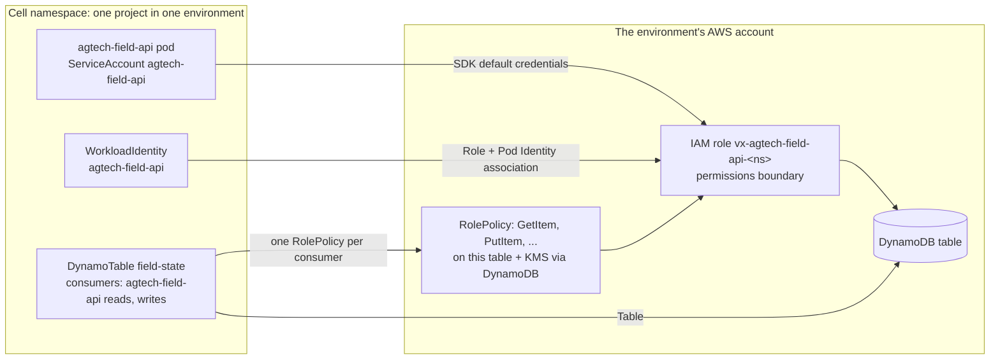

# Platform resources: AWS services for Vrixel products

The AWS services products may use (constitution VX-19), as OpenChoreo ClusterResourceTypes backed
by Crossplane Compositions. The list, and what each is for, lives in the platform catalog
(`vrixel-tools/sdlc-governance`, `platform/aws-resources.yaml`); this repo builds each type in it.
PostgreSQL and Valkey come from OpenChoreo's own
[`provisioner-crossplane`](https://github.com/openchoreo/community-modules/tree/main/provisioner-crossplane)
module, which this one follows in layout and conventions.

Nobody writes these by hand per feature. The SDLC tool's architect picks types from the catalog,
G4 approves them with their access and cost, and the pipeline creates an OpenChoreo `Resource` per
service and binds it to each environment. This repo is what turns those Resources into AWS.

| Type | Builds | Kept when unbound |
| --- | --- | --- |
| `dynamodb-table` | DynamoDB table: on-demand (small, medium) or provisioned (large), point-in-time recovery, deletion protection | yes |
| `kinesis-stream` | Kinesis stream: one shard (small) or on-demand | yes |
| `sqs-queue` | SQS queue plus a dead-letter queue, with an alarm when the data plane has an alarm topic | no |
| `s3-bucket` | S3 bucket: no public access or ACLs, TLS only, versioning, optional expiry and access logs | yes |
| `sns-topic` | SNS topic (never PHI in a message) | no |
| `workload-identity` | One component's IAM role, trusted only through EKS Pod Identity for its ServiceAccount, under the permissions boundary | no |

Every type is encrypted with the product's KMS key and tagged with product, feature and data class.

## How access works



- The pipeline creates a `workload-identity` Resource for each component that reads or writes an
  AWS resource. Its Composition makes the role and the Pod Identity association; the role has no
  policies of its own.
- Each resource's Composition attaches one `RolePolicy` per consumer to the role. The policy holds
  exactly the actions the design gave that component (from the catalog's `access`), on that
  resource only, plus the KMS key through that service only (`kms:ViaService`).
- Roles are named `<namePrefix><component>-<namespace hash>`, so both Compositions agree without
  looking each other up.
- The component reads names and URLs from the environment variables `workload.yaml` binds, and
  never holds keys.

## Install on a data plane (once per product environment)

Each product environment is its own AWS account with an EKS data plane (product.yaml
`runtime.aws`). On each:

1. Crossplane v2 and the EKS Pod Identity Agent add-on.
2. VPC endpoints so traffic stays private: gateway endpoints for DynamoDB and S3, interface
   endpoints for Kinesis, SQS, SNS, KMS and STS.
3. The product's customer-managed KMS key, and a permissions boundary policy that allows only the
   product's resources (names starting with the prefix) and the key.
4. `functions.yaml`, then `aws/provider.yaml`. Before the providers start, give each provider's
   ServiceAccount (`crossplane-system/provider-aws-<service>`) a Pod Identity association to a role
   that may manage its service in this account. provider-aws-iam's role may only create roles
   with the permissions boundary attached.
5. `aws/provider-config.yaml` once the providers are Healthy.
6. `aws/environment-config.yaml`, filled in for this account: account, region, EKS cluster, KMS
   key, permissions boundary, optional alarm topic and access-log bucket.
7. `apis/*/definition.yaml`, `aws/*-composition.yaml` and `cluster-agent-rbac.yaml`.

On the control plane, once: `apis/*/resource-type.yaml`.

**Assumption to confirm:** a component's pods run under a ServiceAccount named after the
component. If OpenChoreo names it differently, set `service_account` on the workload identity
(the SDLC tool would then pass it).

## Checking a Composition

CI renders every Composition twice, before and after AWS reports, then validates the result
against the AWS providers' schemas and the XRDs. To run the same checks locally:

```bash
kind=dynamodb-table
crossplane composition render aws/render/$kind/xr.yaml aws/$kind-composition.yaml functions.yaml \
  --xrd apis/$kind/definition.yaml --required-resources aws/render/environment-config.yaml \
  --observed-resources aws/render/$kind/observed.yaml

VRIXEL_CATALOG=../sdlc-governance/platform/aws-resources.yaml python3 -m pytest tests
```

`tests/` checks the module against the catalog: every type is built, with the same parameters and
outputs, and stored data is kept when its binding goes.

## Adding a type

1. A pull request to the catalog in sdlc-governance: what it's for and not for, data classes,
   parameters, IAM actions per access, sizes with planning costs, built-in defaults, emulator.
2. Here: `apis/<type>/definition.yaml` and `resource-type.yaml`, `aws/<type>-composition.yaml`
   (encrypted with the product key, a `RolePolicy` per consumer, `managementPolicies` without
   `Delete` and `retainPolicy: Retain` if it stores data), and render samples. Add the provider if it's new.
